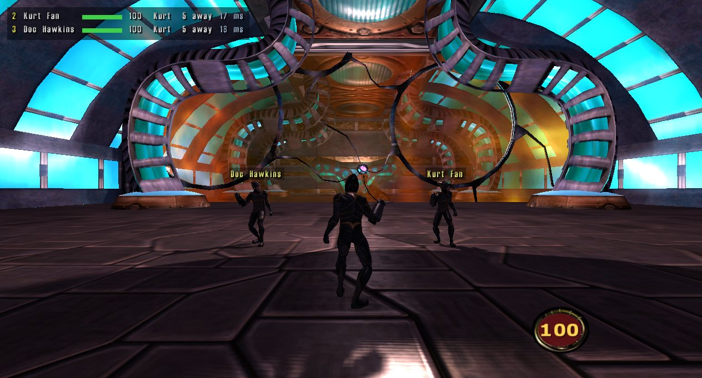

# mdk2-coop

Online co-op for **MDK2 HD**. One player hosts, everyone else joins, and you play the campaign together:
shared enemies, doors, pickups and progress, with going down and being revived instead of dying.

**Status: public alpha.** Every checkpoint of the campaign loads and plays in automated two-player tests,
but nobody has finished the whole campaign in co-op yet. Expect rough edges, and please
[report what breaks](#reporting-a-problem).

No game files are in this repo. Every player needs their own copy of MDK2 HD on Steam.

**[See the showcase](docs/SHOWCASE.md)** for screenshots of every feature.

- [What you get](#what-you-get)
- [Install](#install)
- [Play together](#play-together)
- [Controls](#controls)
- [Settings](#settings)
- [Couch co-op](#couch-co-op-one-pc-2-4-players)
- [Known issues](#known-issues)
- [Help test](#help-test)
- [Reporting a problem](#reporting-a-problem)
- [Uninstall](#uninstall)
- [For developers](#for-developers)

## What you get

- **2 to 16 players** (tested with up to 8), over Steam friends-only lobbies or direct UDP.
- **The whole campaign in co-op**: everyone follows the host from level to level; enemies, their health,
  doors, pickups and shots are the same for everyone. Pickups give their item, ammo or healing to every connected player.
- **What one player does happens for everyone**: when anyone walks into a new room or picks something up, the
  level's scripts run for all of you, and a boss starts when anyone gets near it. If a door closes behind them,
  anyone left outside the area, or on the far side of the door, is brought to them (with a note saying so), like a
  modern co-op game. Everyone can take their own tutorial grenades.
- **Down, not dead**: a hit that would kill you puts you down, and a teammate can stand you up. Bleed out and
  you watch a teammate until your area is clear or the next checkpoint.
- **Cutscenes together**: they start when everyone is ready, skipping is a vote, and nobody moves on until
  everyone has seen the end. The minigames show the other players as ghosts.
- **Co-op saves** every few minutes, so a crash or a dropped connection costs nothing: the same player comes
  back where they were.
- **Players on screen**: a panel with everyone's health and name tags over their heads.
- **Text chat, pings and proximity voice chat.**
- **Switch hero at any time** (Kurt, Max or Doc) and an **emote wheel**.
- **Difficulty presets** (Story, Normal, Hard, Nightmare) or your own mix.
- **Modern controls** (WASD, Space to jump) or the game's originals, a controls page that draws every key,
  and **gamepad** support.
- **A launcher** before the game starts: host, join or play solo, your name, every setting, and a save
  browser that remembers who you played with.
- **Couch co-op**: 2 to 4 players on one PC, one window and one gamepad each.

## Install

You need MDK2 HD: the **Steam** version (build 3902) or the **Overhaul Games** (Beamdog) version. The installer does not check the game version. At every start the mod looks at the game it is in and uses the Steam engine addresses if they fit, the Overhaul ones if not. If neither fits, co-op stays off and `bridge.log` says "unknown game build".

1. Download the zip from [Releases](https://github.com/TommoDotCommo/mdk2-coop/releases) and unzip it
   anywhere (not inside the game folder).
2. Double-click **MDK2-Coop-Setup.exe**. It finds MDK2 HD (Steam libraries or the Overhaul Games folder; browse
   to the folder if it cannot), then choose **Install / Repair**. If the game folder is protected, Windows asks
   for administrator permission. Host or Join, Steam or direct IP
   and the address are chosen in the launcher at every start.
3. Choose **Play MDK2** or **Close** when setup finishes. You can also start MDK2 HD as usual
   from Steam or the Beamdog client. The co-op launcher opens first.

If Windows shows "Windows protected your PC", choose **More info > Run anyway**. The installer uses
PowerShell scripts (`installer-gui.ps1` and `mdk2-coop.ps1`) that you can read in Notepad first.

## Play together

### The launcher

When you start the game, the launcher opens: choose **Host a game**, **Join a friend** or **Play solo**
(plain MDK2 HD, co-op off for that start), your name, Steam or direct UDP, and press **Enter** (or the big
button) to start. The **Saves** tab lists your co-op saves with who played and how far you got, and lets the host
start a new game at any level and checkpoint. The **Settings** tab has every option. **Help** collects what a bug
report needs in one click (see [Reporting a problem](#reporting-a-problem)). **Esc** quits.

Don't want the launcher? **Settings > Display > Show launcher at start: Off**. Hold **Shift** while the game
starts to bring it back. Accepting a Steam invite skips it and joins straight away.

### Over Steam (recommended)

**Host:** start the game, then **Options > Co-op > Session > Invite Steam friends**, or share the numeric
**Lobby ID** shown there. Start a new game or load a save; your friends follow you into your level.

**Join:** start the game, then accept the host's Steam invite, use **Join Game** in Steam's friends list, or
enter their lobby ID in **Options > Co-op > Session > Join lobby by ID**. Start the game before accepting an
invite. Once joined, wait for the host: your game loads automatically. **Esc** cancels joining;
**Session > Join host again** retries. You do not need to choose New Game.

No port forwarding, public IP or extra downloads are needed. Everyone needs Steam online and the same mod
version. If the Steam overlay is off, share the lobby ID instead.

### Over direct UDP (LAN, or manual internet setup)

The host listens on **UDP port 27900** (changeable in the launcher). On a LAN, joiners enter the host's local IP
address. Over the internet, the host forwards that port on their router and shares their public IP address.

In the lobby, **Save address** adds the host address and port to **Saved addresses** without leaving the lobby. Saving an existing address keeps its name and notes. **Join** in Saved addresses takes you straight to the connected lobby.
Allow MDK2 HD through Windows Firewall when asked.

### While you play

- The host decides where everyone goes: level changes, checkpoints and loading saves follow the host.
- **Going down**: hold **R** next to a downed teammate for 3 seconds to stand them up. Down for 30 seconds and you
  are out: you watch a teammate (left click: the next one) and come back when your area is clear of enemies or at
  the next checkpoint. Lava, black holes and falling out of the world are straight out. If everyone is down, the
  checkpoint restarts for everyone.
- **Cutscenes**: press **Backspace** (or Esc) to vote to skip; a majority skips for everyone, and pressing again
  takes your vote back. Press any other key to see the time left and the votes in the bottom right corner. When
  you finish a cutscene first, you wait for the others.
- **If someone's game crashes or their connection drops**, the others wait and that player comes back where they
  were. If the host's game crashes, the host can **Resume co-op** from the Load Game menu and everyone follows.

## Controls

The default is the **Modern** preset. Change it, or rebind any key, in **Options > Co-op > Controls**, which
draws the keyboard and mouse with every key labelled. **Original** gives you the game's own keys.

| Action | Modern preset |
|---|---|
| Move | W A S D |
| Jump, jetpack (Max), parachute (Kurt) | Space |
| Fire | Left mouse |
| Sniper mode (Kurt) | Right mouse |
| Previous / next item | Q / E, or the mouse wheel |
| Open the inventory | F |
| Text chat (Enter sends, Esc cancels) | T |
| Ping what you aim at | V or middle mouse |
| Revive a downed teammate (hold) | R |
| Push to talk | B |
| Emote wheel (hold, point, let go) | H |
| Character wheel (hold, point, let go) | J |
| Vote to skip a cutscene | Backspace |
| Hold for the Mod Quick Guide (launcher or in game) | F1 |
| Put a marker in the logs (for bug reports) | F2 |

The **emote wheel** offers each hero the animations they have; its last slot, **All...**, lists every
animation, a page at a time. The **character wheel** switches you to Kurt, Max or Doc on the spot, keeping your
share of health; **Level's own** goes back to the hero the level gave you.

A **gamepad** (Xbox style) works too: left stick moves, right stick looks, right trigger fires, left trigger is
sniper mode, A jumps, X revives, Y opens the inventory, Back pings, the bumpers change item, B or Start pauses.

## Settings

In the launcher's **Settings** tab, or in game under **Options > Co-op** (on the title screen, or Esc > Options):

- **Co-op / Gameplay** (the host's choice counts): friendly fire, difficulty, how often co-op saves are made,
  back to the level's hero after a level you switched hero in, controls preset, gamepad, developer keys.
- **Difficulty**: Story, Normal, Hard, Nightmare, or each setting on its own: enemy health, extra enemy health per
  player, damage you take and deal, time before you bleed out and time to revive.
- **Interface** (your own): players on screen, player outlines through walls (off by default), the cutscene
  timer, friends in minigames, and the emote wheel, character wheel, text chat and pings, each of which can be
  switched off.
- **Voice and sound**: voice chat on or off, its volume, the hearing range (host), and the game's effects, music
  and speech levels.
- **Display**: windowed or fullscreen, resolution, show the launcher at start.
- **Session** (in game): your name, host or join and the connection type (both next start), Steam lobby status,
  invites, joining by lobby ID, or the UDP host's address. On the host: Resume co-op and Save now.

## Couch co-op (one PC, 2-4 players)

After installing, double-click **Couch.cmd** in the release folder. It starts one game window per player,
tiled on one screen, each played with its own gamepad (player 1 = first pad). Player 1 starts the game from the
title screen and the others follow. Only player 1 has sound, and couch games have no voice chat. Options:
`Couch.cmd -Players 3`, `-Monitor 2`, `-Stop`.

Each window is a whole game (about 370 MB of memory each), so four players need a strong PC. Couch games play
over the local network inside your PC and cannot be combined with online play.

## Known issues

- **Steam networking** has passed automated tests and a real lobby test, but **invites between two separate Steam
  accounts and long internet sessions have not been tested yet**. Most testing so far used direct UDP.
- **No host migration**: if the host leaves, the session ends for everyone. A host who restarts creates a new
  lobby; join its new invite or ID, then the host resumes.
- **The host needs upload bandwidth**: about 1.3 Mbit/s with 8 players in a busy level, less with fewer.
- **Nobody has finished the whole campaign in co-op yet.** Every checkpoint loads and plays in automated
  tests, but those don't solve puzzles or beat bosses.
- Some cutscenes started by events inside a level have no countdown until they have been watched once.
- Real gamepads, microphones and 3-4 couch players have only been tested with simulated input.

## Help test

This is an alpha, and some things can only be tested by real players. These help the most:

- **Steam invites between two different accounts**, and joining by lobby ID.
- **Long sessions over the internet**: an hour or more, with players far apart.
- **Finishing levels together**: puzzles, boss fights and the end of each level.
- **A real gamepad, a real microphone (voice chat), and couch co-op with 3 or 4 players.**

When a session goes well, that is worth hearing too: open a
[playtest report](https://github.com/TommoDotCommo/mdk2-coop/issues/new?template=playtest.yml) with what you
played and how it went.

## Reporting a problem

Ideas are welcome as a [feature request](https://github.com/TommoDotCommo/mdk2-coop/issues/new?template=feature.yml).

Open a [bug report](https://github.com/TommoDotCommo/mdk2-coop/issues/new?template=bug.yml); the form asks for
what's needed:

1. What happened, and what you expected. Press **F2** the moment something goes wrong: it puts a numbered
   marker in every player's log, saves a screenshot (`coop_mark<N>.tga` alongside the log), and every game saves
   the last minute it saw (frame rate, where everyone was, ping and lost packets) next to its log.
2. The diagnostics bundle, from everyone if you can, the host's first. Start the game, and in the launcher open
   **Help > Send diagnostics** (it works after a crash too: start the game again and use it). A few seconds later
   a zip appears on your desktop with the logs of recent runs, your settings and a summary of your PC and network.
   Your Windows and computer names, IP addresses and Steam IDs are replaced before it is zipped; it holds no saves
   and no game files. Attach it to the report. Every run keeps its own log, so nothing is overwritten by playing
   again (the newest 200 MB are kept; a run that crashed is never deleted).
   If the launcher is switched off or won't start, the logs are in `%LOCALAPPDATA%\mdk2-coop\coop\logs`
   (older installs and test copies: the `coop` folder in the game folder); `bridge.log` is the last run.
3. Which player you were (host or which client), your mod version (launcher's About tab), how you connected
   (Steam or UDP), and the level and checkpoint.

## Uninstall

Open **MDK2-Coop-Setup.exe** and choose **Uninstall**. It removes owned mod files, restores verified original files and removes the settings loader while keeping current player options. Co-op settings, logs and saves in `%LOCALAPPDATA%\mdk2-coop\coop` stay;
delete that folder if you like. Older installs may also have data in the game folder's `coop` subfolder.

What the installer changes: `<game folder>\dinput8.dll` (an earlier one is kept as `dinput8.dll.coop-original`),
`<game folder>\coop\` (the mod's script and data-location marker), and one loader line in
`%LOCALAPPDATA%\MDK2HD\settings.lua`, backed up first as `settings.lua.coop-backup`. The game rewrites that file
when you change its options, and the mod puts the line back at the next start. The installer copies existing
co-op data to `%LOCALAPPDATA%\mdk2-coop\coop`, without replacing data already there.
Setup lists file status and refreshes on activation or Refresh. Hash receipts beside deployed files protect
modified payloads and original backups. Review legacy backups before migrating older installations.
See [launcher maintenance](docs/LAUNCHER-MAINTENANCE.md) for recovery and verification limits.

## For developers

- [docs/DEVELOPMENT.md](docs/DEVELOPMENT.md): how the mod works (the dinput8.dll bridge, synchronisation,
  cutscenes, saves, the launcher), the test harness and building a release.
- [docs/TESTING.md](docs/TESTING.md): the automated regression ladder, what it covers and its limits.
- [routes/README.md](routes/README.md): recording and replaying progression routes.

Built with the [Co-op Anything](https://github.com/cranebeaker/coop-anything) playbook; the research notes for
this game live in its `games/mdk2-hd/NOTES.md`.

## License

MIT, see [LICENSE](LICENSE). It covers this repo's code only; MDK2 HD itself is not included.

### Shared combat feedback

Floating hit numbers show host-confirmed enemy HP loss. The combat log and DPS panels are
hidden for now while their presentation is revised. Damage history and counters still record
in the background. Ctrl+M toggles the underlying meter state;
Ctrl+R resets local counters; Ctrl+PgUp/PgDn scroll history and page players; Ctrl+L returns to
live; Ctrl+D dumps recent history to `combat.txt` in the mod data folder. The newest 512
events are also saved automatically. Source labels use projectile IDs or damage-channel IDs.
See [combat feedback](docs/COMBAT.md) for format, authority, limits and verification status.
