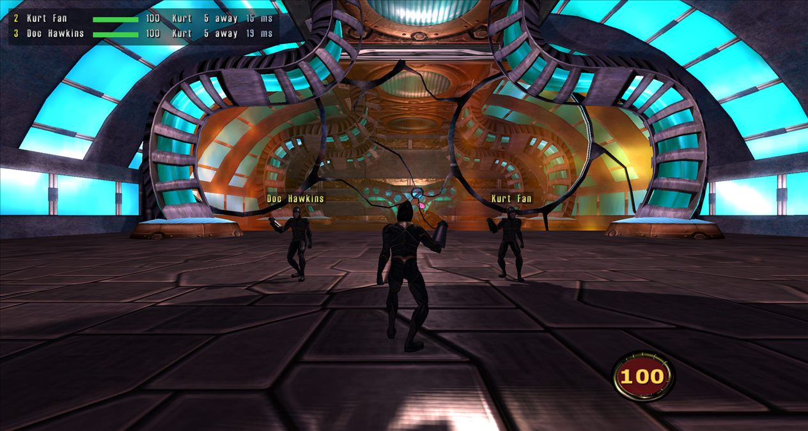

# mdk2-coop

Online co-op for **MDK2 HD**. One player hosts, everyone else joins, and you play the campaign together:
shared enemies, doors, pickups and progress, with going down and being revived instead of dying.

**Status: public alpha.** Every checkpoint of the campaign loads and plays in automated two-player tests,
but nobody has finished the whole campaign in co-op yet. Expect rough edges, and please
[report what breaks](#reporting-a-problem).

No game files are in this repo. Every player needs their own copy of MDK2 HD on Steam.

**[See the showcase](docs/SHOWCASE.md)** for screenshots of every feature.

- [What you get](#what-you-get)
- [Install](#install)
- [Play together](#play-together)
- [Controls](#controls)
- [Settings](#settings)
- [Couch co-op](#couch-co-op-one-pc-2-4-players)
- [Known issues](#known-issues)
- [Help test](#help-test)
- [Reporting a problem](#reporting-a-problem)
- [Uninstall](#uninstall)
- [For developers](#for-developers)
- [Code signing policy](#code-signing-policy)
- [If Windows warns you](#if-windows-warns-you)
- [Privacy](#privacy)

## What you get

- **2 to 16 players** (tested with up to 8), over Steam friends-only lobbies or direct UDP.
- **The whole campaign in co-op**: everyone follows the host from level to level; enemies, their health,
  doors, pickups and shots are the same for everyone. Pickups give their item, ammo or healing to every connected player.
- **What one player does happens for everyone**: when anyone walks into a new room or picks something up, the
  level's scripts run for all of you, and a boss starts when anyone gets near it. If a door closes behind them,
  anyone left outside the area, or on the far side of the door, is brought to them (with a note saying so), like a
  modern co-op game. Everyone can take their own tutorial grenades.
- **Down, not dead**: a hit that would kill you puts you down, and a teammate can stand you up. Bleed out and
  you watch a teammate until your area is clear or the next checkpoint.
- **Cutscenes together**: they start when everyone is ready, skipping is a vote, and nobody moves on until
  everyone has seen the end. The minigames show the other players as ghosts.
- **Co-op saves** every few minutes, so a crash or a dropped connection costs nothing: the same player comes
  back where they were.
- **Players on screen**: a panel with everyone's health and name tags over their heads.
- **Text chat, pings and proximity voice chat.**
- **Switch hero at any time** (Kurt, Max or Doc) and an **emote wheel**.
- **Difficulty presets** (Story, Normal, Hard, Nightmare) or your own mix.
- **Modern controls** (WASD, Space to jump) or the game's originals, a controls page that draws every key,
  and **gamepad** support.
- **A launcher** before the game starts: host, join or play solo, your name, every setting, and a save
  browser that remembers who you played with.
- **Couch co-op**: 2 to 4 players on one PC, one window and one gamepad each.

## Install

You need MDK2 HD: the **Steam** version (build 3902) or the **Overhaul Games** (Beamdog) version. Setup reads the
game's executable (it never runs it) and tells you what it found before you install: *Found: MDK2 HD Steam build 3902*,
*Found: MDK2 HD Overhaul Games build*, or *Found: unknown build (SHA-256 ...)*. For an unknown build Setup warns that
co-op will stay off and installs only if you say so. If you do start such a game, a message box says the same in plain
words and what to do (in Steam: Properties > Installed Files > Verify integrity of game files, and Properties > Betas >
None), and `coop\unsupported-build.txt` keeps the text and the exe's SHA-256 for a bug report.

1. Download **MDK2-Coop-Setup.exe** from [Releases](https://github.com/TommoDotCommo/mdk2-coop/releases). It is one
   file: there is nothing to unzip. (The zip on the same page is for a manual install, below.)
2. Double-click it. It finds MDK2 HD (Steam libraries or the Overhaul Games folder; browse
   to the folder if it cannot), then choose **Install / Repair**. If the game folder is protected, Windows asks
   for administrator permission. Host or Join, Steam or direct IP
   and the address are chosen in the launcher at every start.
3. Choose **Play MDK2** or **Close** when setup finishes. You can also start MDK2 HD as usual
   from Steam or the Beamdog client. The co-op launcher opens first.

Already installed? Open setup and click **Play MDK2** to launch the game. Use **Create desktop shortcut** to add a shortcut that opens the game and its co-op launcher directly. Both buttons are also available after installing. Keep Steam or the Beamdog client running.

**"Windows protected your PC"?** Setup is not code-signed yet, so SmartScreen warns about any new unsigned program:
choose **More info > Run anyway**. Some antivirus programs also dislike that Setup starts PowerShell to run its installer
scripts. Nothing is hidden: `MDK2-Coop-Setup.exe /extract <new folder>` writes the scripts (`installer-gui.ps1`,
`mdk2-coop.ps1`, `install-state.ps1`) and the other files to a folder you can read in Notepad first, and every release
lists its SHA-256 (`MDK2-Coop-Setup.exe.sha256`). Setup unpacks its own files, after checking them against a SHA-256 stored in the
exe, into a fresh folder under `%LOCALAPPDATA%\mdk2-coop\setup\<version>`; it never writes into an existing folder or
through a link. If you opened Setup from inside the zip without extracting it, it says so: extract the whole zip first, or
download the single `MDK2-Coop-Setup.exe`.

### Manual install (from the zip)

Use this if you would rather not run Setup, or on a PC where it will not run. Unzip the release, close the game, then
copy two files into the game folder (the one with `mdk2hd.exe`):

| From the zip | Into the game folder |
|---|---|
| `dinput8.dll` | `<game folder>\dinput8.dll` |
| `coop\coop.lua` | `<game folder>\coop\coop.lua` (make the `coop` folder if it is not there) |

Nothing else is needed: at its first start the mod adds its one loader line to `%LOCALAPPDATA%\MDK2HD\settings.lua`
by itself, and the mod keeps its settings, logs, saves and update backups in `%LOCALAPPDATA%\mdk2-coop`: nothing is
written into the game folder while you play. If another mod's `dinput8.dll` (an ASI loader, a widescreen fix) is
already there, rename it to `dinput8.chain.dll`: the co-op DLL loads it after itself, so both keep working. This is
also how mod managers (Vortex, Mod Organizer 2) install it; `coop-mod.json` in the zip lists the files with their
SHA-256, Setup then shows "Installed by a mod manager" and the in-game updater leaves the update to the manager. The
other files in the zip (`Couch.cmd`, `mdk2-couch.ps1`) are for couch co-op.
The mod does not patch the game executable. Manual uninstall: delete those two files (rename `dinput8.chain.dll` back
to `dinput8.dll` if there was one); optionally delete the `-- >>> mdk2-coop >>>` ... `-- <<< mdk2-coop <<<` block in
`%LOCALAPPDATA%\MDK2HD\settings.lua` (it does nothing without the mod) and the `coop` folders.

### Mod managers

The zip is a drop-in package, so any manager that puts its files in the game folder works. Neither Vortex nor Mod
Organizer 2 knows MDK2 HD yet, so every release also carries a small game extension for each (the `mod-managers` assets on
the release page). Install the mod from the release zip (or from Nexus Mods, where it is the same zip with the same
version). Setup then shows "Installed by a mod manager" with a Play button, and updates come from the manager: the
launcher's update check says "Update it in your mod manager" instead of replacing files.

- **Vortex**: Settings > Extensions > Install From File, choose `mdk2hd-vortex-extension.zip`, restart Vortex, then
  add *MDK2 HD* (found through Steam, or Manually Locate for the Overhaul Games build). Drag the release zip onto Vortex
  and enable it; Deploy. The extension lifts `dinput8.dll` and `coop\coop.lua` out of the zip's top folder, so there is
  no installer step. Start the game from Vortex with *MDK2 Co-op launcher* (the co-op launcher is part of the game's start,
  so this is the game started normally) or from Steam.
- **Mod Organizer 2**: copy `game_mdk2hd.py` into `<MO2>\plugins\basic_games\games\`, restart MO2 and create an
  *MDK2 HD* instance. Install the zip as a mod (the plugin unfolds the top folder and drops Setup and the other helper
  files), then run the *MDK2 Co-op launcher* executable from MO2. Not tested yet: MO2 runs the game inside its virtual
  file system (usvfs), and Windows must load the mod's `dinput8.dll` through it. If the co-op launcher does not open when
  you start the game from MO2, use the Root Builder plugin to deploy the two files into the real game folder, or install by
  hand (above).
- **By hand**: see Manual install above.

### Steam Deck and Linux (Proton): untested

MDK2 HD runs through Proton, and the mod is a `dinput8.dll` proxy. Wine and Proton have their own built-in
`dinput8`, so Steam must be told to load the mod's file first. Untested by the project so far (see Known issues).

1. Install the game in Steam (desktop mode on the Deck) and run it once.
2. Copy the files in: unzip the release on the Deck, open a terminal in the unzipped folder and run
   `sh install-linux.sh install "<game folder>"`, where the game folder is the one with `mdk2hd.exe`, for example
   `~/.local/share/Steam/steamapps/common/"MDK 2 HD"`. It copies the two files, keeps another mod's `dinput8.dll` as
   `dinput8.chain.dll` (any other file that was there as `<file>.coop-original`), never writes through a link, records
   what it did in `coop/install-linux.record`, and writes `"dinput8"="native,builtin"` for `mdk2hd.exe` into the game's
   Proton prefix (`steamapps/compatdata/213350/pfx/user.reg`, backed up first), so no launch option is needed.
   `sh install-linux.sh status --json` says what is installed and whether that override is in place.
3. Only if it said there is no Proton prefix yet (the game never ran): in Steam, right-click MDK2 HD > Properties >
   General > Launch Options and enter exactly `WINEDLLOVERRIDES="dinput8=n,b" %command%` (or start the game once and
   run step 2 again).
4. Start the game from Steam. The co-op launcher opens first. `bridge.log` (or `unsupported-build.txt`) in the prefix's
   `%LOCALAPPDATA%\mdk2-coop\coop` says what happened if it does not.

To remove it: `sh install-linux.sh uninstall "<game folder>" --yes` removes exactly the files it installed (a file you
changed since is left alone), puts the original `dinput8.dll` back, takes its DLL override out of the prefix again, and
refuses to do anything without its record. Clear the launch option if you set one. Both scripts (`install-linux.sh`
and `MDK2-Coop-Setup.exe`) take `status --json`, `install <game folder> --yes` and `uninstall <game folder> --yes`
with exit codes 0 done, 1 failed, 2 usage, 3 unsupported game build, 4 the game is running. Please report whether it worked, with the Proton version, in an
[issue](https://github.com/TommoDotCommo/mdk2-coop/issues).

## Play together

### The launcher

When you start the game, the launcher opens: choose **Host a game**, **Join a friend** or **Play solo**
(plain MDK2 HD, co-op off for that start), your name, Steam or direct UDP, and press **Enter** (or the big
button) to start. The **Saves** tab lists your co-op saves with who played and how far you got, and lets the host
start a new game at any level and checkpoint. The **Settings** tab has every option. **About** has the version,
updates, the quick guide and **Report a problem**, which collects what a bug report needs in one click (see
[Reporting a problem](#reporting-a-problem)). **Esc** quits. A pad works too: stick or D-pad to move, A to press,
B back, LB/RB for tabs, Start for the big button, hold Y for the quick guide.

Don't want the launcher? **Settings > Launcher > Show launcher at start: Off**. Hold **Shift** while the game
starts to bring it back. Accepting a Steam invite skips it and joins straight away.

### Over Steam (recommended)

**Host:** start the game, then **Options > Co-op > Session > Invite Steam friends**, or share the numeric
**Lobby ID** shown there. Start a new game or load a save; your friends follow you into your level.

**Join:** start the game, then accept the host's Steam invite, use **Join Game** in Steam's friends list, or
enter their lobby ID in **Options > Co-op > Session > Join lobby by ID**. Start the game before accepting an
invite. Once joined, wait for the host: your game loads automatically. **Esc** cancels joining;
**Session > Join host again** retries. You do not need to choose New Game.

No port forwarding, public IP or extra downloads are needed. Everyone needs Steam online and the same mod
version. If the Steam overlay is off, share the lobby ID instead.

### Over direct UDP (LAN, or manual internet setup)

The host listens on **UDP port 27900** (Settings > Network). On a LAN or a shared VPN nobody types an address:
**Join a friend** lists the hosts it finds under **Games near you** (every network this PC is on, your Tailscale
devices, and hosts you joined before), with their state, players and ping; pick one and press **Join <name>**.
Or paste what the host sent you into the box above the list: an invite code or link, a Steam lobby number, an
address (with `:port` if it is not 27900) or a computer name.
When nothing is found (over the internet, say), ask the host for their invite.

When you host, the lobby shows **Friends can join by**:
same network, Tailscale, the internet and Windows Firewall, each with what it found and how to fix it. While the
lobby is open it asks your router to open the port (UPnP or NAT-PMP; turn it off in Settings > Network) and
removes the mapping when you leave. **Copy invite** puts one line on the clipboard with a code that carries every
route that works; your friends paste it into **Join** (or open the link). **Invite only** lobbies let in only
friends with that invite. The host can **Kick** a player from the lobby. See [docs/HOSTING.md](docs/HOSTING.md).

Hosts you join are remembered under **Recent hosts** (rename, pin, forget); your old saved addresses move there,
pinned. When the last host is online, **Rejoin <name>** appears on Play. An invite copied to the clipboard is
offered when the launcher comes to the front. In the lobby, **Save address** pins the host.
Allow MDK2 HD through Windows Firewall when asked.

### While you play

- The host decides where everyone goes: level changes, checkpoints and loading saves follow the host.
- **Going down**: hold **R** next to a downed teammate for 3 seconds to stand them up. Down for 30 seconds and you
  are out: you watch a teammate (left click: the next one) and come back when your area is clear of enemies or at
  the next checkpoint. Lava, black holes and falling out of the world are straight out. If everyone is down, the
  checkpoint restarts for everyone.
- **Cutscenes**: press **Backspace** (or Esc) to vote to skip; a majority skips for everyone, and pressing again
  takes your vote back. Press any other key to see the time left and the votes in the bottom right corner. When
  you finish a cutscene first, you wait for the others.
- **If someone's game crashes or their connection drops**, the others wait and that player comes back where they
  were. If the host's game crashes, the host can **Resume co-op** from the Load Game menu and everyone follows.

## Controls

The default is the **Modern** preset. Change it, or rebind any key, in **Options > Co-op > Controls**, which
draws the keyboard and mouse with every key labelled. **Original** gives you the game's own keys.

| Action | Modern preset |
|---|---|
| Move | W A S D |
| Jump, jetpack (Max), parachute (Kurt) | Space |
| Fire | Left mouse |
| Sniper mode (Kurt) | Right mouse |
| Previous / next item | Q / E, or the mouse wheel |
| Open the inventory | F (Tab is the player list now) |
| Text chat (Enter sends, Esc cancels) | T |
| Ping what you aim at | V or middle mouse |
| Revive a downed teammate (hold) | R |
| Push to talk (hold) | B or the mouse side button |
| Emote wheel (hold, point, let go) | H |
| Player list (hold): ping, state, mute, volume, watch | Tab |
| Watch the previous / next player when you are out of the fight | [ and ] (left mouse works too) |
| Character wheel (hold, point, let go) | J |
| Vote to skip a cutscene | Backspace |
| Hold for the Mod Quick Guide (launcher or in game) | F1 |
| Put a marker in the logs (for bug reports) | F2 |

The **emote wheel** offers each hero the animations they have; its last slot, **All...**, lists every
animation, a page at a time. The **character wheel** switches you to Kurt, Max or Doc on the spot, keeping your
share of health; **Level's own** goes back to the hero the level gave you.

A **gamepad** (Xbox style, Steam Deck) works too: left stick moves, right stick looks, right trigger fires, left trigger
is sniper mode, A jumps, X revives, Y opens the inventory, the bumpers change item, B or Menu (Start) pauses, holding
the right stick click talks. **View** (Back) is the co-op button:

| On a pad | Does |
|---|---|
| Tap View | Ping what you aim at |
| Hold View | Player list (right stick and RT: mute, volume, watch) |
| View + D-pad up / LB / RB | Emote wheel / character wheel / quick chat (Ready, Wait for me, ...): right stick picks, let go of View to choose |
| View + D-pad down | Chat: Steam's keyboard, or one on screen (A types, Menu sends, B cancels) |
| View + D-pad left / right | Watch the previous / next player when you are out of the fight |
| View + Y | Mod Quick Guide |

While View is held the D-pad does not move you. After pad input the hints show pad buttons and voice is open mic (Voice
mode: Automatic; Push to talk and Open mic are the other choices).

### Steam Deck and controllers

The mod reads an **Xbox gamepad**, so in Steam the controller must be presented as a gamepad: Steam's own *Gamepad*
template (or *Gamepad with joystick*) is right. The *Keyboard (WASD) and Mouse* templates hide the pad from the mod: the
co-op layer, pad hints and the pad menus then do nothing. Steam shows no controller-support entry for MDK2 HD, so
check this once under the game's **Controller settings**.

On a Steam Deck, pick the community layout **MDK2 Co-op (pad layer)** (Controller settings > Browse Configs >
Community; its file is `dist/steam-input/mdk2-coop_deck.vdf`). It is Steam's Gamepad template plus two back buttons:

| Deck button | Presents | Does in the mod |
|---|---|---|
| L4 (upper left back) | View | Tap: ping. Hold: player list, and the D-pad, LB, RB and Y become co-op buttons (table above) |
| R4 (upper right back) | Right stick click | Hold: push to talk |
| L5, R5 (lower back) | nothing | Free for you to bind |

Every other button is as in the table above (the Deck's own View button works the same as L4). Other controllers have
no back buttons to bind; with them, check that Steam's Gamepad template presents a View (Back) button, as the co-op
layer needs it.

## Settings

In the launcher's **Settings** tab, or in game under **Options > Co-op** (on the title screen, or Esc > Options), whose pages are named like the launcher's sections:

- **Co-op rules** (was Co-op / Gameplay; the host decides, tagged "host decides"): friendly fire, difficulty, how often co-op
  saves are made, back to the level's hero after a level you switched hero in, and (launcher) who can see your lobby.
- **Difficulty**: Story, Normal, Hard, Nightmare, or each setting on its own: enemy health, extra enemy health per
  player, damage you take and deal, time before you bleed out and time to revive.
- **Players and interface** (was Interface; your own): players on screen, player outlines through walls (off by default), the
  DPS meter (off by default; Ctrl+M cycles off, one line, full), the cutscene timer, friends in minigames, and the emote
  wheel, character wheel, text chat and pings, each of which can be switched off. In game this page also has the gamepad
  switch (next start) and the developer keys.
- **Voice and sound**: voice chat on or off, its volume, the hearing range (host), and the game's effects, music
  and speech levels.
- **Controls** (launcher): the preset and the gamepad switch. In game the Controls page shows the keyboard and the
  rebinding.
- **Display**: windowed or fullscreen, resolution.
- **Network** (launcher): the port, finding games on your network and on Tailscale, the router port while hosting, your
  internet address in invites.
- **Launcher** (launcher): show the launcher at start, check for updates, offer pre-releases, developer keys.
- **Session** (in game; the list of Players is part of it): your name, host or join and the connection type (both next start), Steam lobby status,
  invites, joining by lobby ID, or the UDP host's address. On the host: Resume co-op and Save now.

## Couch co-op (one PC, 2-4 players)

After installing, double-click **Couch.cmd** in the release folder. It starts one game window per player,
tiled on one screen, each played with its own gamepad (player 1 = first pad). Player 1 starts the game from the
title screen and the others follow. Only player 1 has sound, and couch games have no voice chat. Options:
`Couch.cmd -Players 3`, `-Monitor 2`, `-Stop`.

Each window is a whole game (about 370 MB of memory each), so four players need a strong PC. Couch games play
over the local network inside your PC and cannot be combined with online play.

## Known issues

- **Steam networking** has passed automated tests and a real lobby test, but **invites between two separate Steam
  accounts and long internet sessions have not been tested yet**. Most testing so far used direct UDP.
- **No host migration**: if the host leaves, the session ends for everyone. A host who restarts creates a new
  lobby; join its new invite or ID, then the host resumes.
- **The host needs upload bandwidth**: about 1.3 Mbit/s with 8 players in a busy level, less with fewer.
- **Nobody has finished the whole campaign in co-op yet.** Every checkpoint loads and plays in automated
  tests, but those don't solve puzzles or beat bosses.
- Some cutscenes started by events inside a level have no countdown until they have been watched once.
- Real gamepads, microphones and 3-4 couch players have only been tested with simulated input.
- **Steam Deck / Linux (Proton) is untested.** The launch option and `install-linux.sh` are tested against fixture
  folders only; nobody has run the game that way yet.
- **An unsupported game build** (for example a Steam beta branch) keeps co-op off with a message; only Steam build 3902
  and the Overhaul Games build are known.
- Setup is **not code-signed yet**: Windows SmartScreen warns before the first run.

## Help test

This is an alpha, and some things can only be tested by real players. These help the most:

- **Steam invites between two different accounts**, and joining by lobby ID.
- **Long sessions over the internet**: an hour or more, with players far apart.
- **Finishing levels together**: puzzles, boss fights and the end of each level.
- **A real gamepad, a real microphone (voice chat), and couch co-op with 3 or 4 players.**

When a session goes well, that is worth hearing too: open a
[playtest report](https://github.com/TommoDotCommo/mdk2-coop/issues/new?template=playtest.yml) with what you
played and how it went.

## Reporting a problem

Ideas are welcome as a [feature request](https://github.com/TommoDotCommo/mdk2-coop/issues/new?template=feature.yml).

Open a [bug report](https://github.com/TommoDotCommo/mdk2-coop/issues/new?template=bug.yml); the form asks for
what's needed:

1. What happened, and what you expected. Press **F2** the moment something goes wrong: it puts a numbered
   marker in every player's log, saves a screenshot (`coop_mark<N>.tga` alongside the log), and every game saves
   the last minute it saw (frame rate, where everyone was, ping and lost packets) next to its log.
2. The diagnostics bundle, from everyone if you can, the host's first. Start the game, and in the launcher open
   **Help > Send diagnostics** (it works after a crash too: start the game again and use it). A few seconds later
   a zip appears on your desktop with the logs of recent runs, your settings and a summary of your PC and network.
   Your Windows and computer names, IP addresses and Steam IDs are replaced before it is zipped; it holds no saves
   and no game files. Attach it to the report. Every run keeps its own log, so nothing is overwritten by playing
   again (the newest 200 MB are kept; a run that crashed is never deleted).
   If the launcher is switched off or won't start, the logs are in `%LOCALAPPDATA%\mdk2-coop\coop\logs`
   (older installs and test copies: the `coop` folder in the game folder); `bridge.log` is the last run.
3. Which player you were (host or which client), your mod version (launcher's About tab), how you connected
   (Steam or UDP), and the level and checkpoint.

## Uninstall

Open **MDK2-Coop-Setup.exe** and choose **Uninstall** (installed by hand or on Linux: see the manual steps under Install). It removes owned mod files, restores verified original files and removes the settings loader while keeping current player options. Co-op settings, logs and saves in `%LOCALAPPDATA%\mdk2-coop\coop` stay;
delete that folder if you like. Older installs may also have data in the game folder's `coop` subfolder.

What the installer changes: `<game folder>\dinput8.dll` (another mod's earlier one is kept as `dinput8.chain.dll`,
which the co-op DLL loads; an older copy of this mod as `dinput8.dll.coop-original`),
`<game folder>\coop\` (the mod's script and data-location marker), and one loader line in
`%LOCALAPPDATA%\MDK2HD\settings.lua`, backed up first as `settings.lua.coop-backup`. The game rewrites that file
when you change its options, and the mod puts the line back at the next start. The installer copies existing
co-op data to `%LOCALAPPDATA%\mdk2-coop\coop`, without replacing data already there.
Setup lists file status and refreshes on activation or Refresh. Hash receipts beside deployed files protect
modified payloads and original backups. Review legacy backups before migrating older installations.
See [launcher maintenance](docs/LAUNCHER-MAINTENANCE.md) for recovery and verification limits.

## For developers

- [docs/DEVELOPMENT.md](docs/DEVELOPMENT.md): how the mod works (the dinput8.dll bridge, synchronisation,
  cutscenes, saves, the launcher), the test harness and building a release.
- [docs/TESTING.md](docs/TESTING.md): the automated regression ladder, what it covers and its limits.
- [routes/README.md](routes/README.md): recording and replaying progression routes.

Built with the [Co-op Anything](https://github.com/cranebeaker/coop-anything) playbook; the research notes for
this game live in its `games/mdk2-hd/NOTES.md`.

## Code signing policy

Release files are **not code-signed yet**. We applied to the SignPath Foundation program for open-source projects
(free code signing provided by [SignPath.io](https://about.signpath.io/), certificate by
[SignPath Foundation](https://signpath.org/)); it asks for more public adoption first, so we will reapply after the
public beta. The [release workflow](.github/workflows/release.yml) is ready for it: release builds are made by GitHub
Actions from this public repository, and once signing is set up it signs `dinput8.dll`, `install-policy.exe` and the
zip's Setup first, then the single-file Setup that carries them, each after the maintainer approves it, and creates a
**draft** release for review. Every binary has ProductName **MDK2 Co-op** and the same ProductVersion, and every
download has a SHA-256 sidecar. See the [signing setup and release procedure](docs/LAUNCHER-MAINTENANCE.md#code-signing).

- Authors and committers: [TommoDotCommo](https://github.com/TommoDotCommo)
- Reviewers: [TommoDotCommo](https://github.com/TommoDotCommo) (changes from other contributors are reviewed before merge)
- Approvers (each signed release is approved by hand): [TommoDotCommo](https://github.com/TommoDotCommo)

## If Windows warns you

Because the files are new and not signed yet, Windows may stop Setup with **"Windows protected your PC"**: click
**More info**, then **Run anyway**. If Microsoft Defender quarantines a file, it is a false positive: we report every
release's files to Microsoft. Check the file's SHA-256 against the `.sha256` file on the release page, then restore it
from Windows Security > Protection history, or install with a mod manager or the zip instead (no Setup needed).

## Privacy

The mod does not collect or send personal data.

- Update check: the launcher asks GitHub's public releases API for this repository at most once a day. No account,
  identifier or usage data is sent. Turn it off with the Auto-check setting on the About page.
- Multiplayer: game and voice traffic go only to the players you choose to host or join (directly, or through
  Steam when you use a Steam lobby).
- Hosting: while your lobby is open the launcher asks your own router (UPnP or NAT-PMP, on your network only) to
  open the port, and reads your Windows Firewall rules without changing them. Turn the router request off in
  Settings > Network.
- Diagnostics: **Send diagnostics** writes a zip to your own Desktop, with your Windows and computer names, profile
  folder and IP addresses replaced first. Nothing is uploaded; you decide whether to attach it to a bug report.

## License

MIT, see [LICENSE](LICENSE). It covers this repo's code only; MDK2 HD itself is not included.

### Shared combat feedback

Floating damage numbers (coloured per player, merging rapid hits into one growing number), a
hitmarker and a kill ticker show host-confirmed enemy HP loss. A small damage panel at the right
edge is off until you turn on Players and interface > DPS meter (launcher or in game); it is then one line
(your DPS and the team's), and Ctrl+M cycles off, line and a bar per player with
DPS, totals and the fight timer; it fades out after the fight. Ctrl+R resets local counters;
Ctrl+D dumps recent history to `combat.txt` in the mod data folder (the newest 512 events are
also saved automatically).
See [combat feedback](docs/COMBAT.md) for format, authority, limits and verification status.
