# mdk2-coop showcase

Online co-op for **MDK2 HD**: one player hosts, the others join, and you play the campaign together.
These are real screenshots from v0.2.1-alpha, taken from the host's game during automated test runs
(the player names are the test harness's). [Download](https://github.com/TommoDotCommo/mdk2-coop/releases/latest)
· [Player guide](../README.md)

## Play together

Everyone follows the host from level to level, and enemies, doors, pickups and shots are the same for everyone.
The panel at the top left shows each player's health, hero, distance and ping, with name tags over their heads.

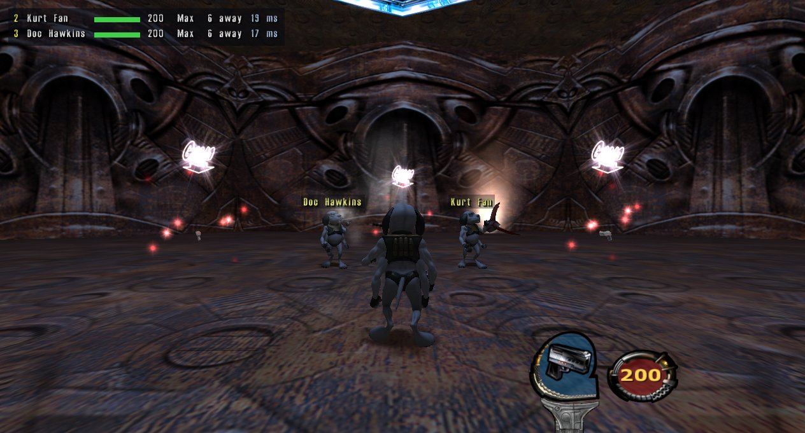

## Down, not dead

A hit that would kill you puts you down. A teammate holds **R** next to you to stand you up; bleed out and you
watch the others until your area is clear or the next checkpoint.

| Down | Reviving |
|---|---|
| 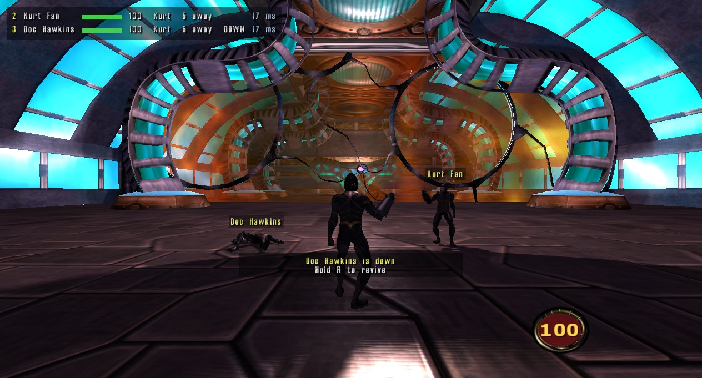 | 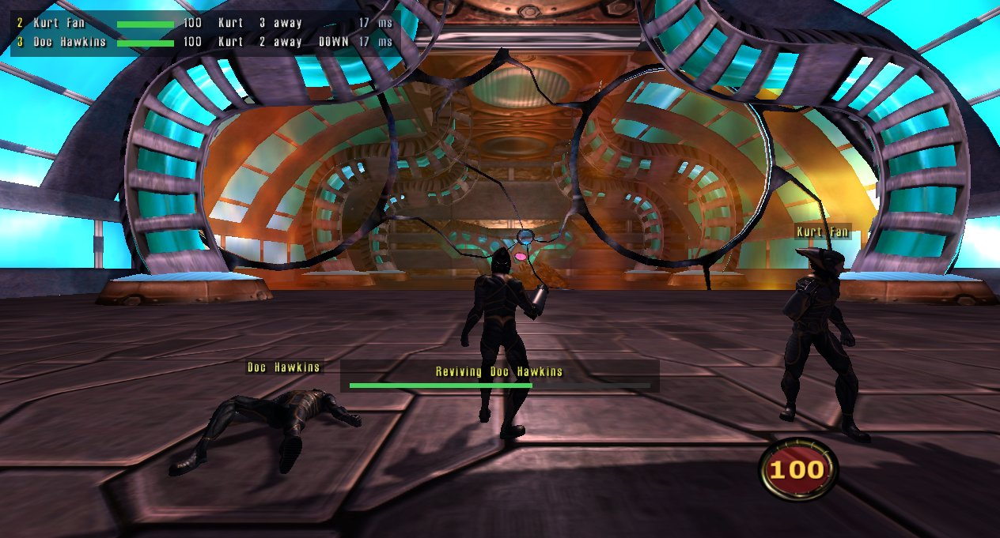 |

## Talk and point

Text chat (**T**) shows over the sender's head and in the corner, with dots while someone types. Pings (**V** or
middle mouse) mark a spot for everyone, and proximity voice chat lets nearby players hear you.

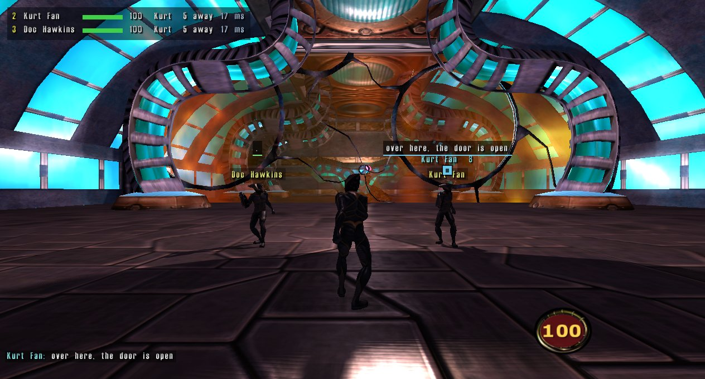

## Switch hero, strike a pose

Hold **J** for the character wheel and play as Kurt, Max or Doc at any time. Hold **H** for the emote wheel, with
the animations your hero has and an "All..." list of the rest.

| Character wheel | Emote wheel |
|---|---|
| 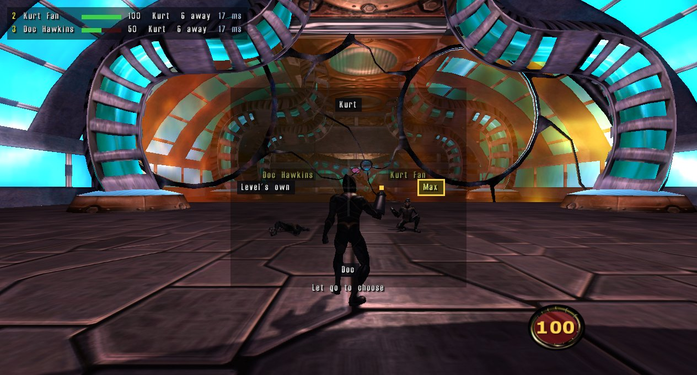 | 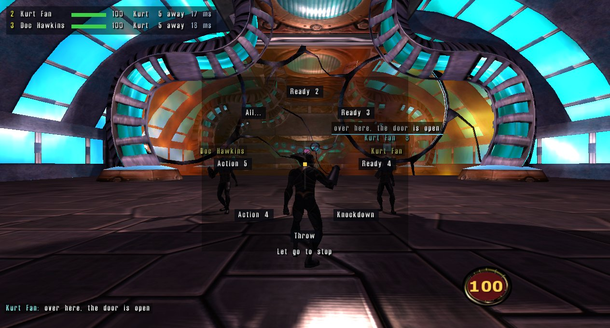 |

## Cutscenes and minigames together

Cutscenes start when everyone is ready, skipping is a vote with a countdown in the corner, and the next part waits
for everyone. In the skydives and torpedo runs the other players fly beside you as ghosts.

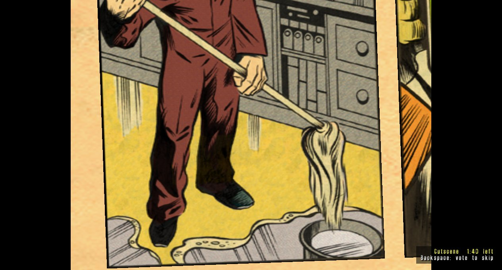

| Skydive | Torpedo run |
|---|---|
| 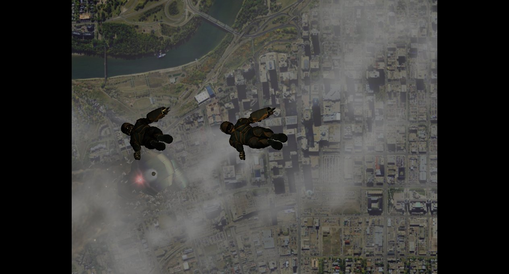 | 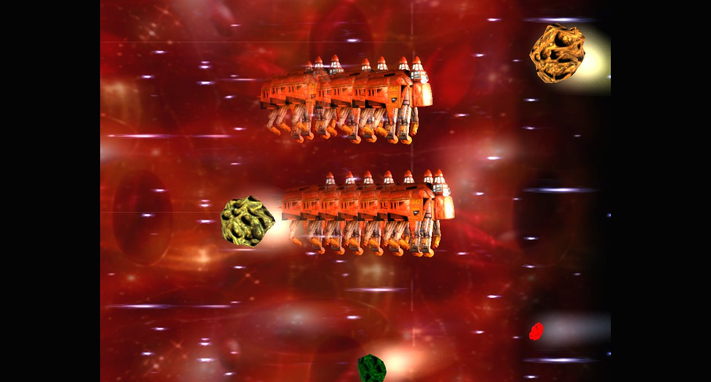 |

## A launcher before the game

Host, join or play solo over Steam lobbies (no port forwarding) or direct UDP. The **Saves** tab lists your co-op
saves with who played and how far you got, and lets the host start at any level and checkpoint.

| Play | Saves |
|---|---|
| 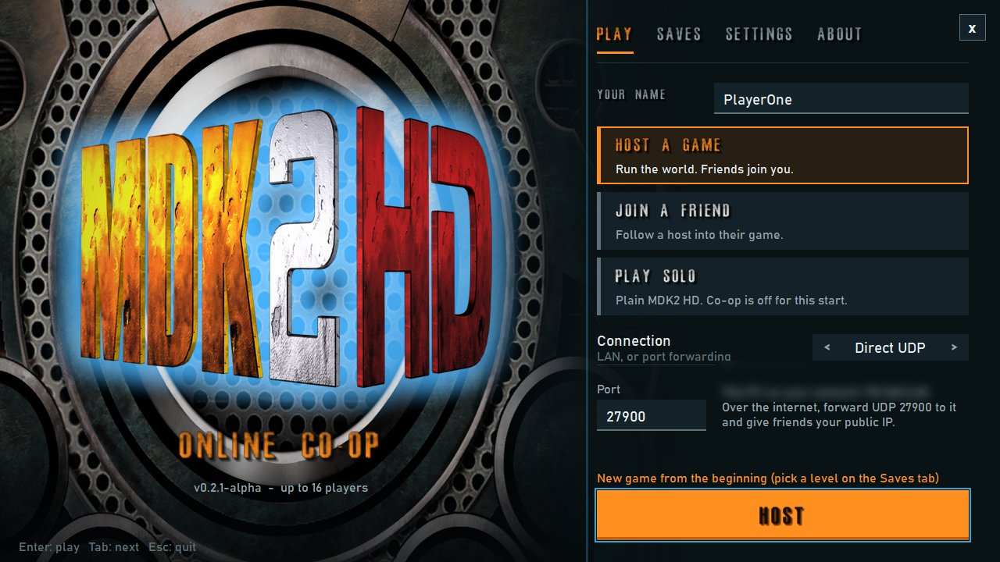 | 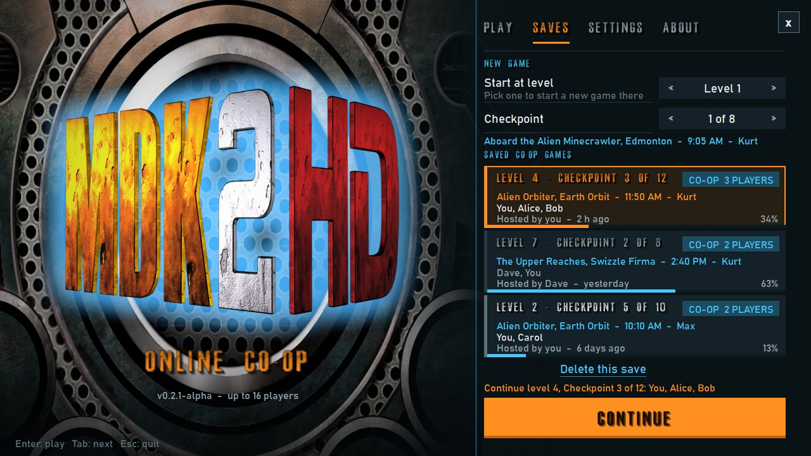 |

## Your controls, your rules

Modern (WASD) or the game's original keys, with a page that draws the keyboard and mouse and labels every key, and
Xbox-style gamepads. Difficulty presets or your own mix, and an Interface page to switch each feature on or off.

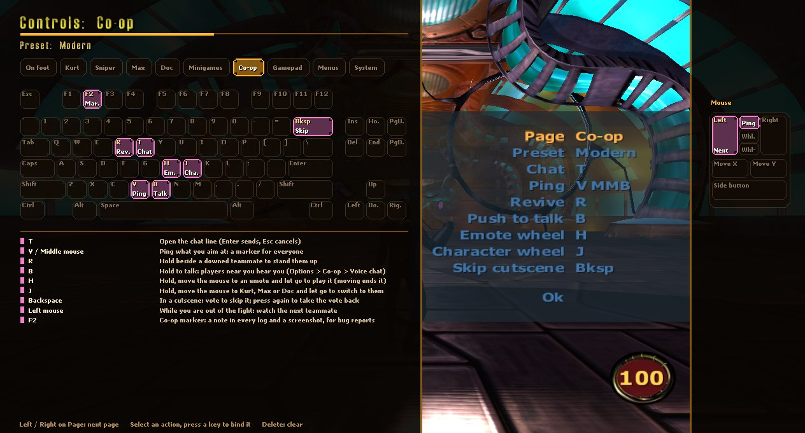

| Gamepad | Difficulty | Interface |
|---|---|---|
| 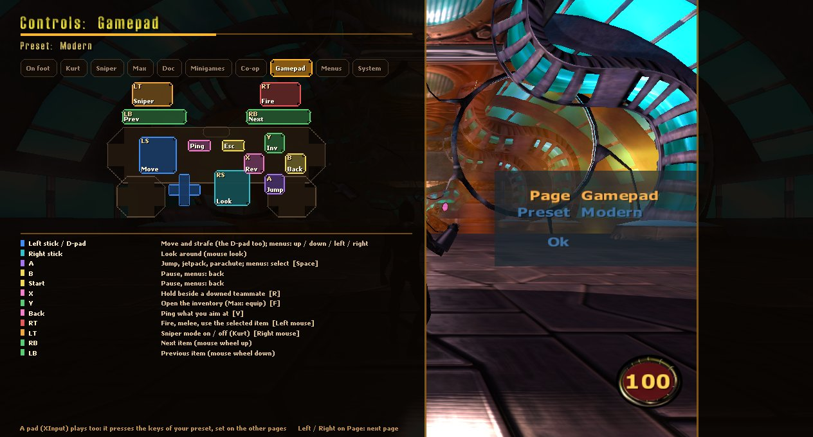 | 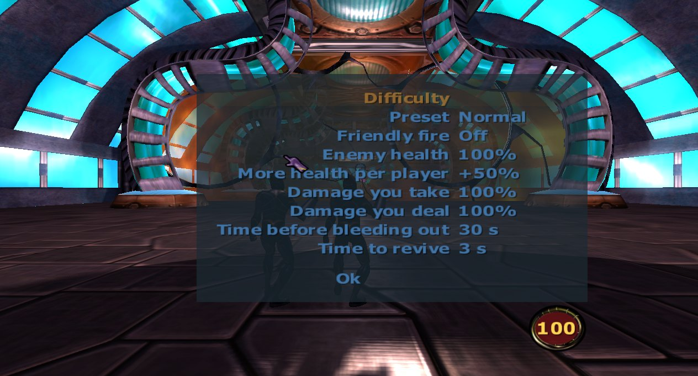 | 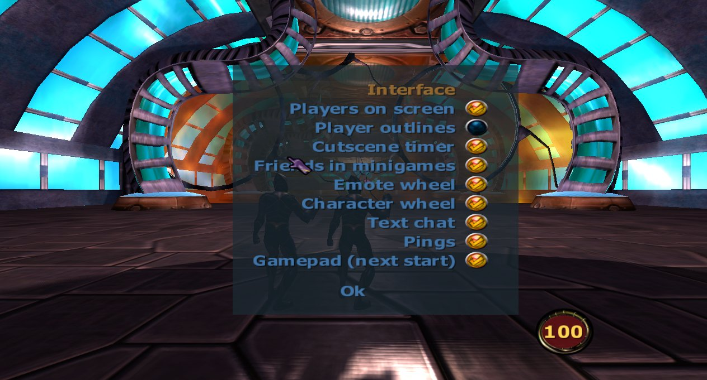 |

---

This is an alpha: see [Help test](../README.md#help-test) for what real players can check that the automated tests
can't, and [report what breaks](../README.md#reporting-a-problem).
